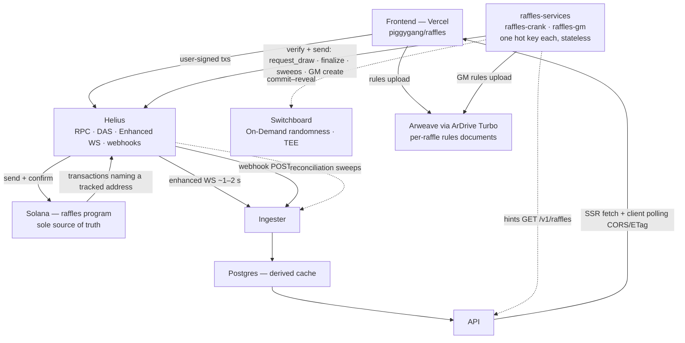
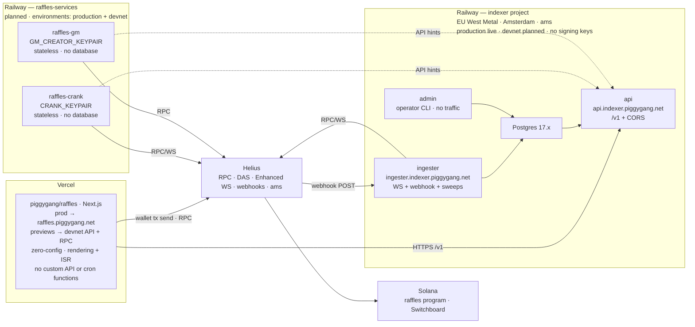

# PiggyGang Raffles — architecture

The end-to-end system behind the free holder-rewards raffles: an Anchor program as the sole source of truth, the Railway-deployed indexer as the entire read backend, a dedicated `raffles-services` project holding the only hot keys, and a Next.js frontend on Vercel. Includes the written decisions on VRF, database and RPC provider.

- **Issue:** [ALG-579](https://linear.app/algolab-si/issue/ALG-579/system-architecture-and-data-flow-design-vercel-anchor-indexing)
- **Milestone:** 1 — Discovery & Architecture
- **Status:** proposed
- **Date:** 2026-11-05
- **Implements:** [spec 1.6](./piggygang-raffles-v1-spec.md) (ALG-578)

## Contents

- [§0 — Document control](#0--document-control)
- [§1 — Overview & component map](#1--overview--component-map)
- [§2 — The big picture](#2--the-big-picture)
- [§3 — Data flows](#3--data-flows)
- [§4 — Deployment topology](#4--deployment-topology)
- [§5 — API contract plan](#5--api-contract-plan)
- [§6 — Client read & write paths](#6--client-read--write-paths)
- [§7 — Decisions — VRF, database, RPC](#7--decisions--vrf-database-rpc)
- [§8 — Devnet & mainnet](#8--devnet--mainnet)
- [§9 — Rebuildability audit](#9--rebuildability-audit)
- [§10 — What this architecture supersedes](#10--what-this-architecture-supersedes)
- [§11 — Risks & open questions](#11--risks--open-questions)

## §0 — Document control

| Field | Value |
| --- | --- |
| Title | PiggyGang Raffles — system architecture & data-flow design |
| Status | `Proposed` → Accepted acceptance = ALG-579 done; the three §7 decisions are the issue's required written decisions |
| Issue | [ALG-579](https://linear.app/algolab-si/issue/ALG-579/system-architecture-and-data-flow-design-vercel-anchor-indexing) in project [PiggyGang Raffles](https://linear.app/algolab-si/project/piggygang-raffles-04d282beca26) |
| Author | Marko Sabec — ALGOLAB |
| Implements | [Feature spec 1.6](./piggygang-raffles-v1-spec.md) (ALG-578, decisions D1–D22 accepted) — product semantics are fixed there and unchanged here |
| Supersedes | The "Next.js + Rust serverless on Vercel + Vercel Cron + Helius webhooks" operational plan (§10 lists every delta) |
| Inputs | indexer decision ALG-618 (Helius Enhanced WebSockets, locked) · the indexer as built at `59c3cac` (source, README, `.railway/railway.ts`, public endpoints probed 2026-11-05) · indexer v1 API contract (`openapi/v1.yaml`) · explorer frontend conventions · dressme wallet code |
| Changelog | `1.0 — 2026-08-27` — initial proposal `1.1 — 2026-08-27` — converted to markdown as the canonical in-repo format (the styled HTML deliverable is retired; Linear keeps the uploaded copies) `1.2 — 2026-11-05` — PIG-112, the revision Linear calls architecture v1.1: matched to the as-built indexer and spec 1.6. A webhook lane runs alongside the WebSocket and neither replays (flows b, f); the origin allowlist is dropped (§6); `raffles-services` ships two binaries with one key each; admin writes are Squads proposals (§6); `api.indexer.piggygang.net` is live (§8); flows d, e, h and §9 follow D19–D22. |

### Design invariants

- **Invariant A** — The Solana chain is the sole source of truth. Postgres is a derived, disposable cache — rebuildable from chain, never authoritative (§9).
- **Invariant B** — No server ever sees, proxies or holds a user key or a user-signed transaction. Users sign in the browser and send straight to RPC.
- **Invariant C** — The only hot keys in the system live in one Railway project, `raffles-services`, as env-only secrets: `raffles-crank` holds `CRANK_KEYPAIR`, `raffles-gm` holds `GM_CREATOR_KEYPAIR`, and no process holds both. Each signs only its own operational transactions.
- **Invariant D** — Every lifecycle step past the deadline is permissionless on-chain. The crank is the reliable "anyone", never a required trust party — its outage degrades liveness, not correctness.

## §1 — Overview & component map

Four repos, four responsibilities. The backend is the existing `piggygang/indexer` Rust workspace on Railway — the previously planned Rust-serverless-on-Vercel application layer is retired (§10).

| Repo | Status | Owns |
| --- | --- | --- |
| **piggygang-raffles-program** `Anchor · new` | New | The program: Config, Raffle, EntryReceipt, EntryPosition, Prize Allowlist, Creator Registry PDAs; every instruction from the spec; Switchboard On-Demand integration behind a narrow provider seam. Publishes the IDL as a versioned artifact consumed by the indexer and the frontend. **All authoritative raffle state lives here.** |
| **piggygang/indexer** `Rust · Railway · extended` | Extended | The entire read backend. Workspace grows: `crates/raffles` (IDL-derived account/event decoding, PDA derivation), the raffles program id on both ingest lanes in `services/ingester` (ALG-623), raffles projections in Postgres (with `crates/data-model`, ALG-619), raffles endpoints added to `openapi/v1.yaml` and `services/api`. Stays strictly read-only — no keys, no transaction sending, exactly as designed. |
| **piggygang/raffles-services** `Rust · Railway · new` | New | The automation service: draw crank, VRF commit–reveal driver, settlement sweeps, GM raffle scheduler. Own repo, own Railway project, mirrors the indexer's build conventions (Dockerfile, config style, CI). Ships two binaries, so each process holds exactly one hot key: `raffles-crank` (`CRANK_KEYPAIR`) and `raffles-gm` (`GM_CREATOR_KEYPAIR`). Stateless — no database of its own, nothing durable (§3c). |
| **piggygang/raffles** `Next.js · Vercel · this repo` | Extended | The frontend at `raffles.piggygang.net` (already reserved in the website's app registry, accent `#3ddad7`). Explorer-style clone: vendored OpenAPI spec, generated `openapi-fetch` client, Server Components, DressMe look — plus the org's first transaction-signing wallet code, extended from dressme's `lib/wallet.ts`. |

> **Retired:** the `piggygang-raffles-application` monorepo (Next.js + Rust serverless functions on Vercel) and Vercel Cron. Next.js rendering and ISR still run on Vercel, but this design adds no custom API or cron functions there: application server-side compute is Railway, full stop.

## §2 — The big picture

One diagram, the whole system. Writes go down the left — a user signs in the browser and the transaction goes straight to the chain. Reads come back around the right — the program's transactions stream into the ingester, land in Postgres, and are served by the API to both server-rendered pages and polling client islands. The two `raffles-services` binaries orbit the chain independently, using the API only as a hint.

*The complete data flow: the user write path (browser-signed, straight to chain), the read path (chain → ingester → Postgres → API → frontend), and the operational path of `raffles-services`. Dashed edges are periodic or advisory. The Postgres box is a cache; every solid fact originates in the program box.*

## §3 — Data flows

### a — Holder claims entries

1. Server Component renders the raffle page from `GET /v1/raffles/{address}` via the server-side `API_BASE_URL` (freshness per flow g).
2. A client island connects the wallet (Wallet Standard, dressme's `lib/wallet.ts` pattern — read-only connect first).
3. The client fetches `GET /v1/wallets/{addr}/eligible-entries?raffle=…` directly from the API (CORS, §6). The response carries `asOfSlot` so the UI can label freshness. Advisory only — the program is the enforcer.
4. The client builds `claim_entries` transactions from the IDL (~6 NFT proofs per tx; a cap-10 claim is normally two), the wallet signs, and the client sends via `NEXT_PUBLIC_SOLANA_RPC_URL` (Helius, provider-restricted).
5. The confirmed transaction reaches the ingester over the WebSocket within ~1–2 s, with the webhook lane as a second path. The UI optimistically updates, then polls the wallet's entries until the receipts appear (flow g). On a lost race the program rejects ("this pig was just used"), and the client rechecks the batch on-chain before rebuilding, because the index may have missed the receipt (spec §6).

### b — Event ingestion

1. Any raffles transaction lands on-chain.
2. Helius delivers it on two lanes, selected by `INGEST_TRANSPORTS` (production is configured for `ws,webhook`): Enhanced WebSockets, and a webhook the ingester receives at `POST /webhooks/helius`. Both lanes compile from one address list, `registry::tracked_addresses`, so the raffles program id joins that list (PIG-149). It reaches the single `TransactionFilter` in the `SubscriptionSpec`, live-updatable via the watch channel, and the webhook's `accountAddresses` through `indexer-admin webhook`. It doesn't get a filter of its own: `claim_entries` also names tracked mints, so a second filter would deliver and bill those transactions twice. The tight address list keeps the 20-credits/MB budget bounded.
3. The webhook is a trigger, not a data source: the receiver files the delivery in `webhook_inbox`, and a drain re-fetches the transaction with `getTransaction`, because the raw payload's index-form instructions aren't what the decoder reads.
4. The ingester decodes instructions and Anchor events with `crates/raffles` (IDL-derived Borsh), then writes idempotently: an append-only `raffle_events` log plus projections (`raffles`, `entry_receipts`, `entry_positions`, `winners`). Each event is keyed by signature and `event_index`, its ordinal in the transaction in instruction order, inner instructions included, the way the indexer's `activity.seq` works. So a Squads bundle or a batched close keeps every event, and every lane derives the same key. One Postgres transaction per signature commits all of its events and their projection updates together, and projections change only for events actually inserted. A transaction delivered on both lanes is a no-op the second time.
5. Each lane keeps its own cursor, and `last_processed_slot` persists only on `SlotCheckpoint`. Neither lane replays: a WebSocket has no `fromSlot`, so `ResumeFrom::Slot` is only a floor, and a webhook delivery can be lost for good. A second lane narrows the gap, and the signature sweep (flow f) closes it on a cursor of its own.
6. Transactions are the only signal, on both lanes — no per-PDA `accountSubscribe` in v1. Account state is a fold of the event log; the snapshot sweep (flow f) catches divergence. Fewer subscriptions, fewer credits, one code path to trust.

### c — Draw lifecycle

1. The crank ticks (~30 s). Hint: `GET /v1/raffles?state=active` from the public API, filtered to `end_ts ≤ now ∧ entries ≥ 1`. If the API is down: fall back to `getProgramAccounts` with a Raffle-discriminator memcmp — raffle counts are small, chain scanning is cheap.
2. Verify before acting: `getAccountInfo` on the Raffle PDA. Already Drawing or Drawn → someone else cranked it (permissionless by design); treat as success and move on.
3. Send `request_draw` signed by `CRANK_KEYPAIR`: fresh blockhash, Helius priority-fee estimate, bounded retries with re-sign.
4. Switchboard commit–reveal: commit the randomness account, wait ~2 slots, reveal, then `fulfill_draw` + finalize — the winner and `drawn_at` are written to the Raffle PDA. The VRF fee was creator-funded at create; the crank pays only tx fees. A missed reveal window → re-commit, bounded, then alert.
5. The whole sequence flows back through flow b. **The crank writes nothing anywhere** — ingestion is the only recorder of outcomes.

### d — Sweeps & claimables

An hourly `raffles-crank` pass, same hint-then-verify shape, in this order per raffle:

1. `reclaim_prize` for zero-entry expiries, cancellations and lapsed 30-day claim windows, on every raffle whoever created it (D21). It fails while a prize can't move (spec E-S10): the crank retries on the next pass, alerts after repeated failures, and carries on with the other raffles.
2. Batched `close_entry_accounts` (many accounts per tx) on terminal raffles with open entry accounts, and on Drawn raffles past `drawn_at` + the claim window + the grace (spec E-S8). Rent goes to each account's recorded payer, never the crank.
3. `close_raffle` once the prize is out and `open_entry_accounts` is zero.

Funds-out paths are never blocked by the pause matrix, so sweeps run regardless of pause state.

### e — GM auto-creation

An in-process scheduler in its own binary, `raffles-gm` (daily/weekly per config — this is what replaces Vercel Cron), so the GM key never shares a process with the crank key. It signs with `GM_CREATOR_KEYPAIR` — an ordinary creator-registry member with zero special program privileges. Idempotence: a deterministic per-period tag in the create transaction, checked against both API and chain before creating; a missed period is skipped, never back-filled. Pre-flight checks prize inventory, SOL balance and the upload price, and refuses to half-create. Each raffle gets its own rules document: `raffles-gm` generates it, uploads it to Arweave through Turbo with the same key, and carries `rules_uri` and `rules_hash` in `create_raffle` (D20, [rules design](./piggygang-raffles-rules.md) §5c). Reclaims and closes stay with the crank, so a reclaimed GM prize simply lands back in the GM wallet as inventory (D21).

### f — Reconciliation, backfill, cold start

The indexer's as-built reconciliation covers NFT ownership only: a 30-second DAS tip probe, an hourly sweep and a weekly deep pass. DAS can't see raffle PDAs, so raffles needs the three mechanisms below, on the same scheduler. None exists yet.

| Mechanism | Cadence | What it does |
| --- | --- | --- |
| **Signature sweep** | ~10 min | `getSignaturesForAddress(program_id)` from the tip back to the sweep's own cursor; fetch and ingest anything either lane missed. It never starts from a lane's cursor, which has already moved past what that lane missed. Its cursor moves up to the walk's newest signature only after every signature in the range is durably ingested: a failed fetch or ingest leaves it in place, so that signature stays retryable and a walk cut short repeats on the next sweep. The gap closer, and load-bearing, because neither lane replays (PIG-120). |
| **Snapshot diff** | hourly | `getProgramAccounts` with discriminator filters, diffed against projections; divergence is logged and repaired (PIG-156). |
| **Cold start** | on demand | Empty database → `indexer-admin backfill-raffles` replays `getSignaturesForAddress` + `getTransaction` from the program's deploy slot → full rebuild (PIG-159). This is the rebuildability guarantee (§9). NFT ownership continues to come from the existing collection indexer's DAS sweeps. |

### g — Frontend reads

Split by volatility instead of fighting the org's `revalidate = 300` convention:

- **Countdowns poll nothing.** `end_ts` is immutable — SSR delivers it once, a client island ticks locally. Most of the perceived "live data" tension dissolves here.
- Archives and winners: Server Components, `revalidate = 300` as usual.
- Active raffle pages: Server Components with a per-route `revalidate = 30`.
- Live numbers (entry counts, state flips, my entries, eligible entries): client islands polling the API directly every 15–30 s, each route on the cache semantics §5 declares. Wallet-scoped data is never SSR'd; wallet identity exists only in the browser.
  - Entry counts and state flips come from public routes with an ETag. The browser's HTTP cache revalidates with `If-None-Match` by itself, and a 304 is nearly free on both ends; scripts can't do it by hand, because `ETag` isn't readable cross-origin (§6).
  - My entries (`raffle-entries`, `private, max-age=5`) may sit in the browser's private cache for 5 s. That spares a repeat read, not a poll: with no ETag there is nothing to revalidate, so a 15–30 s poll gets a full response.
  - Eligible entries (`eligible-entries`, `private, no-store`) are never stored, so there is nothing to revalidate and every poll gets a full response.

### h — Eligible entries

Computed entirely in `services/api` against Postgres — no chain call in the request path: the wallet's held Piggies (existing ownership tables, DAS-reconciled) minus mints with an `EntryReceipt` for this raffle, intersected with the raffle's snapshotted membership rules, then cap-remaining and Full-Gang-bonus preview from the wallet's `EntryPosition`. The response carries `asOfSlot`; a just-bought pig may lag until ownership catches up, but the claim transaction carries the on-chain proof — the API can only under- or over-promise the UI, never affect correctness. The claim transactions also need each Token Metadata pig's token account, which the indexer doesn't store yet (PIG-135).

## §4 — Deployment topology

Two Railway projects plus Vercel. The indexer project stays exactly what it is — read path only. The new `raffles-services` project is deliberately separate: different failure modes (a crashing transaction sender must never take down ingestion), a different secret class (keypairs exist only there), and independent pause/deploy cycles. Inside it, each binary is its own Railway service, so one process holds one key. Because both take hints from the public API and verify on-chain, they need no database and no private networking to anything — full decoupling at the cost of nothing.

*Two Railway projects and Vercel. Signing keys exist only in the raffles-services project, one per service; the indexer project is read-only infrastructure; the frontend has no server-side compute beyond rendering.*

### Services

| Service | Project | Binary | Restart | Healthcheck | Postgres | Signing keys |
| --- | --- | --- | --- | --- | --- | --- |
| `api` | indexer | `indexer-api` | `ON_FAILURE` | `/health` | read; runs migrations at boot | none |
| `ingester` | indexer | `indexer-ingester` | `ON_FAILURE`, self-supervising | `/health` | **live writer** | none |
| `admin` | indexer | `indexer-admin` | `ON_FAILURE` | none — idles for `railway ssh` | operator writes: migrate, seed, backfills | none |
| `raffles-crank` | raffles-services | `raffles-crank` | `ON_FAILURE`, self-supervising | `/health` (PIG-122) | none — API hints + RPC | `CRANK_KEYPAIR` |
| `raffles-gm` | raffles-services | `raffles-gm` | `ON_FAILURE`, self-supervising | `/health` (PIG-122) | none — API hints + RPC | `GM_CREATOR_KEYPAIR` |

**Restart policy can't be set through IaC.** `config apply` silently drops `restartPolicyType` and `restartPolicyMaxRetries` (indexer `.railway/railway.ts`, checked 2026-08-31), so every service runs on Railway's default: `ON_FAILURE`, at most 10 restarts. A healthcheck only gates a deploy and never restarts a running service. A long-running binary therefore supervises itself: it restarts its own loops with a capped backoff, forever, and a watchdog restarts a loop that stops making progress, all in-process, so none of it spends a Railway restart. It exits non-zero only for config or database failures at boot, which a restart can't fix. That is how a service ends up stopped: once the 10 restarts are spent, Railway marks the deployment `Crashed`, notifies project members and leaves it down. Recovery is manual: fix the cause, and a variable change redeploys on its own; for anything else, use Redeploy or Restart on the crashed deployment. `raffles-services` follows the same pattern, which replaces the `ALWAYS` in PIG-122.

### Environment variables

| Scope | Variables |
| --- | --- |
| Shared concept (both projects) | `SOLANA_CLUSTER` (`devnet \| mainnet-beta`) · `SOLANA_RPC_URL` · `SOLANA_WS_URL` · `RUST_LOG` — explicit URLs, not derived, so a provider swap is a config change. Parsed fail-fast (indexer `crates/config` style: missing → default, unparseable → hard error), except that backend services require `SOLANA_CLUSTER`. Startup fails if it is missing, or if the selected cluster's endpoints or per-cluster program config are missing or disagree with it, because a default could silently point a service, hot keys included, at the wrong cluster. A cluster without the program yet says so in its `raffles.toml`, so this doesn't make the refactor wait for the program (§8). The frontend's separate devnet default stays. |
| indexer project | `PORT`/`HOST` (api, ingester) · `HELIUS_API_KEY` · `DATABASE_URL=${{Postgres.DATABASE_URL}}` reference var, private networking, rustls · ingester only: `INGEST_TRANSPORTS=ws,webhook`, `HELIUS_WEBHOOK_SECRET`, `WEBHOOK_URL`. The raffles program id lives in a per-cluster `raffles.toml`, not an env var: the indexer keeps on-chain addresses in `config/` (PIG-134). |
| `raffles-crank` (secret) | **`CRANK_KEYPAIR`** — disposable ops/fee-payer key: rotate freely, hold ~0.1–0.5 SOL, balance-alerted. Plus `RAFFLES_PROGRAM_ID`, `SWITCHBOARD_QUEUE`, priority-fee knobs. Env-only, never in a repo, never on Vercel. |
| `raffles-gm` (secret) | **`GM_CREATOR_KEYPAIR`** — creator-registry member with on-chain identity and GM prize inventory; rotation is an admin registry op. Plus `RAFFLES_PROGRAM_ID`, `GM_SCHEDULE`. Env-only, never in a repo, never on Vercel. |
| Vercel | `API_BASE_URL` (server, SSR) · `NEXT_PUBLIC_API_BASE_URL` (client polling) · `NEXT_PUBLIC_SOLANA_CLUSTER` · `NEXT_PUBLIC_SOLANA_RPC_URL` (provider-restricted, org rule) · `NEXT_PUBLIC_ADMIN_MULTISIG` (proposal mode, §6). Previews point at devnet. |

Two keys in two processes on purpose: compromise of the disposable ops key never touches the GM key's registry identity or prize inventory, and vice versa, and a bug in one binary can't sign with the other's key.

## §5 — API contract plan

**Extend `openapi/v1.yaml` additively** — same file, same service, new `raffles` tag. Adding endpoints is non-breaking under the frozen-v1 rule; the two-step workflow holds and simply gains a second consumer: the contract change ships first and on its own (PIG-118; implementation issues keep `git diff --exit-code openapi/` clean), then explorer *and* raffles re-sync via `pnpm sync:spec`, both with the spec-drift CI check. A separate spec or service was rejected: it would split the contract-of-record and buy nothing — same database, same conventions, same deploy.

All new endpoints inherit the frozen conventions: camelCase with every field required (absence = explicit `null`), cursor `PageInfo`, the `ErrorResponse` envelope, ETag + `Cache-Control`, the contract's `X-RateLimit-*` headers (declared today, enforced once PIG-121 lands), `security: []`, versioning in the server URL. The two wallet routes are the exception on caching: they are `private` and carry no ETag, while the contract says every `GET` returns an ETag and defines `Cache-Control` as "Always `public`", so PIG-118 gives them their own header definitions.

| Endpoint | Purpose | Cache |
| --- | --- | --- |
| `GET /v1/raffles?state=&prizeCollection=&creator=&cursor=` | Browse: active / ending / past, by prize collection | public, max-age=15 + ETag |
| `GET /v1/raffles/{address}` | Detail: prize, counts, state, winner, VRF proof link, `asOfSlot` | public, max-age=5 + ETag |
| `GET /v1/raffles/{address}/entries?cursor=` | Entry positions and ranges (draw verification) | public, max-age=15 + ETag |
| `GET /v1/winners?cursor=` | History: prize, winner, entries, proof — the transparency page | public, max-age=300 + ETag |
| `GET /v1/wallets/{address}/raffle-entries?cursor=` | My entries across raffles, odds, claimables, closeable rent | private, max-age=5 |
| `GET /v1/wallets/{address}/eligible-entries?raffle=` | Flow h — eligible mints, cap remaining, bonus preview, `asOfSlot` | private, no-store |
| `GET /v1/raffles-config` | Prize Allowlist, Creator Registry, config snapshot values, pause state | public, max-age=60 + ETag |
| `GET /v1/raffles-config/changes?cursor=` | Admin change log: registry, authority and config events | public, max-age=60 + ETag |

Wallet-scoped but public and read-only is fine: every byte is derivable from public chain data by anyone with an RPC. The obligations are correct cache directives (`private`/`no-store` — no shared-cache poisoning) and rate limiting (§11), not auth.

## §6 — Client read & write paths

### Reads — direct to the API, with CORS

The API already allows any origin (`actix-cors` with `allow_any_origin`; GET, HEAD and OPTIONS only; no credentials). The origin allowlist this section once planned is dropped. The API is public, unauthenticated and read-only, so there is nothing for an allowlist to protect, and non-browser clients ignore CORS anyway. It would also break every Vercel preview, because each deployment gets a fresh origin. The abuse control is per-IP rate limiting (PIG-121), with SSR and `raffles-services` exempt by a shared-secret header.

Client islands poll `/v1` directly via `NEXT_PUBLIC_API_BASE_URL`. Server Components keep the server-side `API_BASE_URL` for SSR. Same URL; it stops being a secret, which was always a deployment convenience, not a security property, for a `security: []` API.

**Headers scripts can't read.** The API sets no `Access-Control-Expose-Headers`, so cross-origin scripts can't see `ETag`, `Retry-After` or `X-RateLimit-*`. Revalidation still works on the routes with an ETag, because the browser's HTTP cache sends `If-None-Match` itself (flow g). PIG-121 should expose `Retry-After` and `X-RateLimit-*`; otherwise a client can only back off from a 429 by reading the `ErrorResponse` body.

Why direct beats a Next route-handler proxy: a proxy funnels every client through Vercel egress IPs, collapsing the contracted per-client RateLimit semantics into one bucket — disqualifying on its own; it also costs a function invocation per poll tick and adds a hop, where direct polling with ETags costs the API a 304.

### Writes — browser-signed, straight to chain

The dressme wallet pattern, extended to signing: the client builds transactions from the IDL, the wallet signs via Wallet Standard, the client sends via `NEXT_PUBLIC_SOLANA_RPC_URL` (Helius, domain-restricted and rate-limited at the provider). **Neither Vercel nor Railway ever sees, proxies or holds a user key or a user-signed transaction** (Invariant B). The only server-held keys are those of `raffles-services`, each signing only its own operational transactions (Invariant C).

`/create` uploads the rules document to Arweave through ArDrive Turbo before `create_raffle` (D20). Turbo is a third party that receives only the public document, never a transaction, so Invariant B holds.

### Admin writes — Squads proposals

On mainnet the admin authority is a Squads v4 vault, so `/admin` and DAO-created raffles on `/create` don't send program instructions from a wallet. The page raises a Squads proposal, members approve it, and the program sees the vault's signature. `NEXT_PUBLIC_ADMIN_MULTISIG` turns on this proposal mode; on devnet a single keypair signs directly ([registries design](./piggygang-raffles-registries.md) §8). Invariant B holds, because members still sign in the browser. These writes reach the indexer as CPIs from `vault_transaction_execute`, so `crates/raffles` reads inner instructions and events.

## §7 — Decisions — VRF, database, RPC

The three written decisions ALG-579 requires. Each records the decision, the comparison it rests on, and the condition that would reopen it.

### ADR-1 · VRF — Switchboard On-Demand — **decided**

|  | Switchboard On-Demand | ORAO |
| --- | --- | --- |
| Cost | ~0.002 SOL/request (historical figure; re-verify at integration) | ~0.001 SOL base + request-account rent |
| Model | TEE-attested randomness, commit–reveal, ~2 slots | Oracle network, request/callback |
| Integration | Active Anchor SDK; needs a crank to commit + reveal | Simple Rust SDK; callback fits crankless designs |
| Fit here | The crank exists by construction — the burden is already paid | Callback advantage is moot for us |
| Ecosystem | Broad Solana adoption, audited, actively maintained | Smaller footprint |

**Decision:** Switchboard On-Demand — formalizing accepted spec decision D3. **Why:** the stronger security model (TEE attestation vs trusting a smaller operator set) for the one component whose only job is unbiasable winner selection; the commit–reveal crank burden lands on a service that must exist anyway for draws and sweeps; the ~0.001 SOL delta is noise against a creator-funded fee. The program keeps the provider seam narrow — `fulfill_draw` verifies a provider-specific proof account — so ORAO stays a real fallback, and the crank drives providers behind a trait. **Revisit if:** Switchboard's devnet queues prove unreliable for ALG-602 E2E (validate in week one — §11), fees change materially, or the on-demand service is deprecated.

### ADR-2 · Database — Railway Postgres — **decided**

|  | Railway Postgres | Neon | Supabase |
| --- | --- | --- | --- |
| Locality | Same project/region as ingester + api, private networking, zero egress | Cross-cloud hop + egress | Cross-cloud hop, public pooler |
| Durability | Snapshots, not PITR | PITR | PITR |
| Extras | None — none needed | Branching (nice, unneeded) | Auth/realtime/storage — nobody needs these: the API is the realtime layer and there is no auth |
| Ops | Reference vars, one bill, docker-compose parity (PG 17.x) | Second vendor | Second vendor |

**Decision:** Railway Postgres — the database the indexer already plans, unchanged by raffles. **Why:** the database is a derived cache; the snapshots-not-PITR caveat is already accepted in the indexer docs and §9 preserves the chain-rebuildability that justifies it, so PITR buys nothing. Colocation with the write and read paths plus single-vendor ops beat features designed for databases that are sources of truth. **Revisit if:** rebuild-from-chain time grows past an acceptable outage window, or read load demands replicas Railway can't provide.

### ADR-3 · RPC & ingest provider — Helius — **decided**

|  | Helius (Developer, $49/mo) | Triton |
| --- | --- | --- |
| Streaming | Enhanced WebSockets (`transactionSubscribe`) plus webhooks; LaserStream gRPC on Business behind the same `IngestSource` trait | Yellowstone gRPC — excellent, but a new adapter at a higher entry price |
| NFT data | DAS — independently mandatory for holder eligibility + reconciliation | No DAS equivalent; a second provider would still be needed |
| Region | ams endpoints — the Railway region was chosen for them | Varies |
| Budget | 10M credits/mo; WS 20 credits/MB; webhooks 1/event plus a `getTransaction`; DAS 10/call — tight filters are policy | Different model |
| Status | Locked by indexer decision ALG-618; webhooks since added as a second lane, still "never a source of truth" | — |

**Decision:** Helius, unchanged — formalizing locked ALG-618 for the raffles context. Raffles adds one address to the tracked list and modest sweep traffic to an already-budgeted plan. **Why:** DAS is independently mandatory, the region already matches, and splitting providers doubles ops for no gain. **Revisit if:** credit metering (§11) shows raffles pushing past the 10M budget — the relief valve is the pre-planned Business-plan LaserStream, an adapter swap behind the existing trait, not an architecture change.

## §8 — Devnet & mainnet

The indexer has no cluster concept today. It hardcodes mainnet Helius hosts (`crates/ingest/src/ws/mod.rs`, `crates/das/src/client.rs`), defaults `HELIUS_WEBHOOK_API` to a mainnet host, names its stream cursors `helius-ws:mainnet` and `helius-webhook:mainnet`, and ships one mainnet `config/collections.toml`. Raffles introduces a cluster as **config, not code**: `SOLANA_CLUSTER`, `SOLANA_RPC_URL`, `SOLANA_WS_URL` and the Helius hosts (PIG-113), plus per-cluster registries and a `raffles.toml` with the program id and deploy slot (PIG-134) — fail-fast parsed, threaded through all services.

- **Two Railway environments per project** (`production` = mainnet, `devnet`; only the indexer's `production` exists today, PIG-116 and PIG-122 add the rest), each with its own Postgres (indexer project) and its own variables — same code, same config files, only values differ (devnet program ID, devnet keys with airdropped SOL, same Helius key). A separate Railway project per cluster was rejected (duplicated setup, no extra isolation); a single deployment with env-var switching was rejected (a mainnet ingester can't also watch devnet, and E2E must never touch production Postgres).
- **Development ladder:** Anchor localnet with a mocked randomness account for program tests → devnet with real Switchboard On-Demand for the full loop → ALG-602 E2E against the devnet Railway environment: seed registry → create → claim → short-duration end → crank draws → assert winner via `GET /v1/raffles/{address}` → sweep closes → assert rent returned.
- **Frontend:** Vercel previews point `NEXT_PUBLIC_API_BASE_URL` + `NEXT_PUBLIC_SOLANA_RPC_URL` at devnet; production points at mainnet.
- **Ordering constraint:** the cluster-config refactor (PIG-113, PIG-134) lands before the ingester's raffles subscription and before the devnet environment is provisioned (PIG-116). It doesn't need the program, so it can start any time, but `SOLANA_CLUSTER` has to be set in production before it deploys: the variable is required (§4), and a merge never applies `.railway/railway.ts`. The mainnet domain is done: `api.indexer.piggygang.net` serves production and the contract's `servers` block names it. The devnet domain arrives with PIG-116.

## §9 — Rebuildability audit

The indexer's founding property — "the entire DB is rebuildable from chain" — justifies its snapshot-only backups and must survive raffles. Every piece of raffles state, and where it is authoritative:

| State | Authoritative source | Postgres role |
| --- | --- | --- |
| Raffle config, state, timestamps, winner, prize | Raffle PDA + escrow ATA, or the Core asset the Raffle PDA owns (D22) | derived projection |
| Entries, ranges, bitmask, bonus, rent payer | EntryReceipt / EntryPosition PDAs | derived projection |
| Allowlist, registry, config values, pause | Config / Allowlist / Registry PDAs | derived mirror |
| NFT ownership (eligibility input) | Chain, via DAS | derived (existing indexer) |
| Raffle title / short description | **Must ride in `create_raffle` instruction data** (or the Raffle PDA) — flag 1 below | derived |
| Rules content behind `rules_uri` | Arweave document, committed by `rules_hash` on the Raffle — flag 2 below | cache only |
| Ingest checkpoints, sweep cursor | Operational only, resettable | — |
| Crank bookkeeping | None — the crank is stateless by design | — |

> **Flag 1 — title/description:** if these existed only as rows typed into Postgres, rebuildability dies and the API becomes a second source of truth. Requirement for the program team (feeds ALG-585): carry the short title (and a description or its hash) in the `create_raffle` instruction data — instruction data lands in the replayable transaction log, which is enough. Postgres stays a pure fold of chain data.

> **Flag 2 — rules content (resolved):** resolved by spec D20: Arweave via Turbo plus `rules_hash` on the Raffle. The published rules (a legal artifact, spec Invariant 2) are tamper-evident whatever the host or gateway.

**The honest nuance:** after settlement, `close_entry_accounts`/`close_raffle` reclaim rent and the PDAs cease to exist (entry accounts can also close at the spec E-S8 backstop, while the Raffle stays). For closed raffles, rebuildability rests on the *transaction log*, not account state: authoritative for live state = accounts; authoritative for history = archival replay (flow f cold start). That depends on archival `getSignaturesForAddress`/`getTransaction` coverage for the program ID (§11). Belt and braces: a periodic logical dump of the append-only `raffle_events` table is cheap insurance that never becomes a source of truth — replay always wins on conflict.

## §10 — What this architecture supersedes

Deltas against the project description and the spec's original operational assumptions. Product semantics (spec D1–D22) are untouched; in each row below, **this document wins**. Spec 1.6 carries the spec rows.

| Where | Was | Now |
| --- | --- | --- |
| Project description | Rust serverless functions on Vercel | Rust services in the `indexer` Railway project (api, ingester, admin) + `raffles-services` (`raffles-crank`, `raffles-gm`) |
| Project description | Vercel Cron for lifecycle automation | The schedulers inside `raffles-crank` (draw loop, sweeps) and `raffles-gm` (GM cadence) |
| Project description · spec §6 | Helius webhooks → ingest | Helius Enhanced WebSockets and webhooks as two lanes through one idempotent writer, plus reconciliation sweeps. ALG-618's verdict on webhooks ("3-retries-then-lost — never a source of truth") stands: the webhook is a trigger, and the sweeps carry completeness |
| Spec §3 actor table | Crank = "Vercel Cron or anyone" | Crank = "`raffles-crank` or anyone" — the permissionless property, the load-bearing part, is preserved verbatim |
| Repo plan (ALG-591) | `piggygang-raffles-application` monorepo (Next.js + Rust on Vercel) | Retired. Frontend = this repo; backend = indexer; automation = raffles-services; program = piggygang-raffles-program |
| Backend issues (ALG-592, ALG-595) | Webhook indexer · Vercel Cron jobs | Re-scope to ingester subscription + crank service; the *what* (idempotent indexing, auto-draw, retries, sweeps, alerting) is unchanged, the *where* moves |
| Reaffirmed | raffles.piggygang.net · the spec's program design and D1–D22 (Switchboard per D3) · frozen v1 API conventions · the read-only, no-keys indexer philosophy — now protected structurally by putting the crank in its own repo | |

## §11 — Risks & open questions

| # | Risk | Mitigation / action |
| --- | --- | --- |
| R1 | Ingest gaps (WebSocket reconnects, ingester downtime) → stale reads | Neither lane replays, so the 10-min signature sweep (PIG-120) is what closes a gap. The webhook lane narrows it, and `asOfSlot` makes lag visible instead of silent. Quantify max acceptable staleness for the UI. |
| R2 | Helius credit budget — claims are bursty on popular drops | Per-source credit metering from day one; tight filters are already policy; Business-plan LaserStream is the pre-planned relief valve (ADR-3). |
| R3 | Closed-raffle history depends on archival transaction coverage | Verify Developer-plan archival `getSignaturesForAddress` depth for the program ID; hedge with the `raffle_events` dump (§9) — replay wins on conflict (PIG-159). |
| R4 | Crank key ops: drained fee payer, runaway retries | Balance alerts on both keys; a retry circuit breaker so a bug can't burn the ops key on priority fees; GM pre-flight checks inventory + SOL and refuses to half-create. |
| R5 | Switchboard on devnet unproven for us | Validate queue availability + reveal latency in week one of program development — it is ADR-1's revisit trigger, and late discovery stalls ALG-602. |
| R6 | Public API abuse — CORS is open and no limit is enforced yet; wallet-scoped endpoints are JOIN-heavy and can't use a shared cache: `eligible-entries` is `no-store` and `raffle-entries` gets only 5 s in the browser's private cache, so each poll is answered in full (flow g) | Per-IP rate limiting in actix honoring the contracted `X-RateLimit-*` headers (PIG-121); keep eligible-entries queries indexed and cheap; optionally front public-cacheable routes with a CDN. |
| R7 | Reveal window under congestion — missed reveals cost re-commits | Priority-fee strategy with a congestion mode; monitor reveal-success rate. |
| R8 | "I just bought this pig, why can't I enter?" — API lag vs chain truth | `asOfSlot` labeling, UI copy, and an on-chain fallback check when a claim fails eligibility the API predicted. |
| R9 | ~6 proofs/tx is an estimate — compute limits may move it | Coordinate with the program team early; UI batching and the eligible-entries response shape (pre-chunked account triples) depend on it. |
| R10 | Ordering: cluster config | Domains and CORS are resolved: `api.indexer.piggygang.net` is live and there is no allowlist to configure. Still open: land the cluster config (PIG-113, PIG-134) before the raffles subscription and the devnet environment (PIG-116). |
| R11 | Permissionless races — crank vs public callers | Benign by design: a lost race is a cheap failed tx; crank treats "already done" as success, not failure. |
