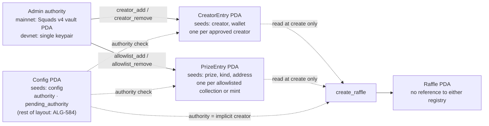
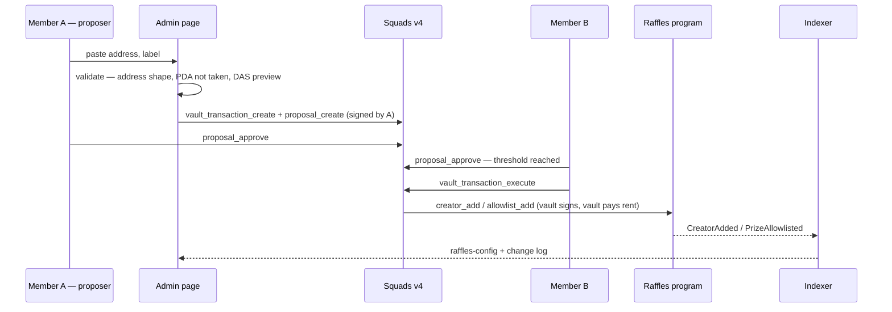

# PiggyGang Raffles — Prize Allowlist & Creator Registry

The two on-chain registries that gate raffle creation in the free model: which assets may be prizes, and which wallets may create raffles. Account layouts, seeds, the admin instruction set, the checks `create_raffle` performs, the admin authority model and the admin runbooks. Written to be reviewed before program work starts.

- **Issue:** PIG-88
- **Status:** proposed
- **Date:** 2026-10-27
- **Implements:** [spec](./piggygang-raffles-v1-spec.md) §3, §10, E-C1, E-C2, E-C6, E-C7, E-A5 — semantics fixed there, mechanics here

## Contents

- [§0 — Document control](#0--document-control)
- [§1 — The answers](#1--the-answers)
- [§2 — Storage model](#2--storage-model)
- [§3 — Account layouts](#3--account-layouts)
- [§4 — Admin instructions](#4--admin-instructions)
- [§5 — Registry checks at creation](#5--registry-checks-at-creation)
- [§6 — Admin authority](#6--admin-authority)
- [§7 — Admin flows](#7--admin-flows)
- [§8 — Indexer, API & frontend](#8--indexer-api--frontend)
- [§9 — Deltas against the spec](#9--deltas-against-the-spec)
- [§10 — Decisions](#10--decisions)
- [§11 — Open questions & hand-offs](#11--open-questions--hand-offs)
- [§12 — Review](#12--review)

## §0 — Document control

| Field | Value |
| --- | --- |
| Title | PiggyGang Raffles — Prize Allowlist & Creator Registry design |
| Status | `Proposed` → Reviewed → Accepted<br>acceptance = PIG-88 review; unblocks the registry instructions and the `create_raffle` registry checks in the program repo |
| Issue | PIG-88 — related: PIG-91 (the feature spec). ALG-numbered issues below are cited exactly as the spec and architecture docs cite them. |
| Author | Marko Sabec — ALGOLAB |
| Implements | [Feature spec 1.6](./piggygang-raffles-v1-spec.md) (decisions D1–D22 accepted) and [architecture](./piggygang-raffles-architecture.md) — product semantics unchanged; the few mechanical additions are listed in §9 |
| Defers | The rest of the Config and Raffle PDA layouts (ALG-584) · prize escrow mechanics and supported token standards (ALG-585) · admin UI implementation (ALG-600) · API shapes (ALG-593) |
| Changelog | `1.2 — 2026-11-05` — §3, §8 and §9 follow spec 1.6 (PIG-112)<br>`1.1 — 2026-11-04` — `PrizeKind` 2 `CoreCollection` (PIG-132, spec D22)<br>`1.0 — 2026-10-27` — initial proposal |

**What this document is authoritative for:** the byte layout and seeds of the registry accounts; the registry and authority instructions and their validation; the registry checks inside `create_raffle`; the admin authority setup; the admin runbooks.

**Naming.** Per spec R11 the word "whitelist" is retired. The **Prize Allowlist** holds the assets that may be prizes, and the **Creator Registry** holds the wallets that may create raffles. The issue title still uses the old word. Code identifiers follow the new names (§9). There is no payment-token list, because there are no payments.

## §1 — The answers

The three things PIG-88 asks to decide:

- **Storage — one PDA per entry.** Any wallet other than `Config.authority` is an approved creator if and only if `CreatorEntry` exists at `[b"creator", wallet]`. The authority creates without one (RD4). An asset is an allowed prize if and only if `PrizeEntry` exists at `[b"prize", kind, address]`. Adding an entry is `init` and removing one is `close`, with rent back to the authority. Only the admin authority can do either. `create_raffle` takes the relevant entries as accounts and checks them (§5).
- **Admin authority — a Squads v4 multisig on mainnet, a single keypair on devnet.** This confirms spec §10 / E-A5. `Config.authority` holds the multisig's **vault PDA**. Transfer is two-step (`set_authority` → `accept_authority`), and `init_config` is gated to the program's upgrade authority (§6).
- **De-listing never touches live raffles.** Entries are read only inside `create_raffle`. No raffle stores a reference to them, and no later instruction reads them. That is the mechanical form of E-C6/E-C7: closing an entry cannot affect anything that already exists.

## §2 — Storage model

Three ways to hold a registry on Solana, compared on what matters here:

|  | **PDA per entry** | One account, `Vec<Pubkey>` | Merkle root on Config |
| --- | --- | --- | --- |
| Membership check in `create_raffle` | Pass one account. Anchor checks owner, discriminator and seeds, so the check is O(1) and its compute is flat. | Deserialize the whole list and scan it. Cost grows with registry size in every create. | Verify a proof passed in instruction data. Costs compute and transaction bytes. |
| Capacity | Unbounded | Realloc limits (10 KiB per instruction); must be sized or grown | Unbounded |
| Add / remove | `init` / `close`: one account, rent back on close | Realloc and shift; one shared writable account | Recompute the root off-chain and write it |
| Client membership check | Derive the PDA and call `getAccountInfo`: one RPC call, no indexer | Fetch and decode the whole list | Needs an off-chain proof service, which puts the indexer in the create path (against architecture Invariants A and D) |
| Change history | One event per add/remove, one account per member | Diff the list | Diff opaque roots |
| Contention | None. `create_raffle` only reads; each entry is its own account. | Every add write-locks the account every create reads | Every update write-locks Config |
| Cost | Rent per entry (~0.0015 SOL), refunded on remove | One rent deposit | Near zero |

**Decided: PDA per entry** (RD1). The registries are small (tens of creators, tens to low hundreds of prize entries), change rarely, and are read once per raffle. A PDA-per-entry design keeps the `create_raffle` check constant-cost and lets the browser and the crank check membership with one `getAccountInfo`. The event log becomes the change history ALG-600 needs, one row per change. The rent is refundable and small enough to ignore.

There is no "disabled" flag. **The entry existing is the membership.** Suspending someone means removing them, and reinstating them creates a fresh entry. The event log keeps the history; the account doesn't need to.

## §3 — Account layouts

Anchor `#[account]`, Borsh, little-endian. Enums are stored as plain `u8` and converted with `TryFrom` so the byte values are explicit and stable across program versions. Offsets include the 8-byte Anchor discriminator. `_reserved` bytes are written as zero and ignored by readers. They give a future program version room for per-entry policy without a realloc migration.



*Dashed edges are reads. Nothing after `create_raffle` reads a registry entry, which is why removing one is always safe for live raffles.*

### Config — registry-relevant fields only

Singleton at seeds `[b"config"]`. Its full layout (membership rules, cap, bonus, duration bounds, pause flag) belongs to ALG-584. This design needs two fields from it:

| Field | Type | Bytes | Notes |
| --- | --- | ---: | --- |
| `authority` | `Pubkey` | 32 | The admin. On mainnet, the Squads v4 **vault** PDA, never the multisig account (§6). Implicitly an approved creator (RD4). |
| `pending_authority` | `Pubkey` | 32 | `Pubkey::default()` = none. Written by `set_authority`, consumed by `accept_authority`. |

### CreatorEntry — the Creator Registry

Seeds `[b"creator", wallet.as_ref()]`, canonical bump.

| Offset | Field | Type | Bytes | Notes |
| ---: | --- | --- | ---: | --- |
| 0 | discriminator | `[u8; 8]` | 8 | Anchor `account:CreatorEntry` |
| 8 | `bump` | `u8` | 1 | Stored canonical bump |
| 9 | `wallet` | `Pubkey` | 32 | The approved creator. Duplicates the seed so that `getProgramAccounts` results decode without the seed. Can be an off-curve address: a partner's own Squads vault is a valid creator. |
| 41 | `added_at` | `i64` | 8 | `Clock::unix_timestamp` at add |
| 49 | `label` | `[u8; 32]` | 32 | UTF-8, zero-padded, non-empty — "Partner X", "GM bot". It is the only on-chain link between a wallet and the vetted organizer behind it (spec §13: the organizer must be identifiable). Project names only, never personal data (spec Invariant 3). |
| 81 | `_reserved` | `[u8; 32]` | 32 | Zero. Room for per-creator policy (e.g. a prize scope or a concurrent-raffle limit) if v1.1 wants one. |
| | **total** | | **113** | Rent ≈ (128 + 113) × 6,960 lamports ≈ **0.0017 SOL**, refunded on remove |

### PrizeEntry — the Prize Allowlist

Seeds `[b"prize", &[kind], address.as_ref()]`, canonical bump. Because `kind` is part of the seed, a collection entry and a mint entry for the same address are separate accounts with separate meanings, so there is no ambiguity about what an entry admits.

| Offset | Field | Type | Bytes | Notes |
| ---: | --- | --- | ---: | --- |
| 0 | discriminator | `[u8; 8]` | 8 | Anchor `account:PrizeEntry` |
| 8 | `bump` | `u8` | 1 | Stored canonical bump |
| 9 | `kind` | `u8` (`PrizeKind`) | 1 | See below. `memcmp` at offset 9 lists one kind. |
| 10 | `address` | `Pubkey` | 32 | What the entry admits, interpreted by `kind` |
| 42 | `added_at` | `i64` | 8 | `Clock::unix_timestamp` at add |
| 50 | `_reserved` | `[u8; 32]` | 32 | Zero |
| | **total** | | **82** | Rent ≈ (128 + 82) × 6,960 lamports ≈ **0.0015 SOL**, refunded on remove |

No label here, unlike `CreatorEntry`. Collection and token names come from metadata/DAS, and a second, admin-typed name could drift from them.

#### PrizeKind

| Value | Name | `address` is | Admits |
| ---: | --- | --- | --- |
| 0 | `Collection` | A Metaplex Certified Collection — the collection NFT's mint (the issue's "verified collection address") | Any NFT whose Token Metadata `collection` is `{ key: address, verified: true }` |
| 1 | `Mint` | An SPL Token mint | Exactly that mint. Either a single NFT (a 1/1, a DressMe voucher) or a fungible SPL token (D11). SOL prizes are wSOL, so allowlisting SOL means a `Mint` entry for the wSOL mint. |
| 2 | `CoreCollection` | A Metaplex Core collection | Any Core asset whose `update_authority` is `Collection(address)` (spec D22) |
| 3+ | — | unassigned | 3 is reserved for single Core assets (§11 Q2). The `u8` leaves room without migrating any account. |

**Budget.** 20 creators plus 60 prize entries lock about 0.12 SOL of vault rent, all of it returned when the entries are removed.

## §4 — Admin instructions

Every instruction here is open while the program is paused, per the spec §10 pause matrix. `set_authority` and the four registry instructions check `signer == config.authority`. The two exceptions are `init_config`, which requires the program's upgrade authority, and `accept_authority`, which requires `pending_authority`. The authority pays rent on add and receives it on close. On mainnet that account is the Squads vault, so the vault needs a small SOL balance (§6).

| Instruction | Signer | Args | Validation | Effect | Event |
| --- | --- | --- | --- | --- | --- |
| `init_config` | The program's upgrade authority | config params (ALG-584) | Signer equals `ProgramData.upgrade_authority_address`, read from the upgradeable loader's ProgramData account | Creates Config with `authority = signer`, `pending_authority = default` | `ConfigInitialized` |
| `set_authority` | `authority` | `new_authority: Pubkey` | — | `pending_authority = new_authority`. Passing `default` cancels; calling again overwrites. **Does not change `authority`.** | `AuthorityProposed` |
| `accept_authority` | `pending_authority` | — | `pending_authority != default` and signer matches it | `authority = pending_authority`; `pending_authority = default` | `AuthorityAccepted` |
| `creator_add` | `authority` | `wallet: Pubkey`, `label: [u8; 32]` | `wallet != default`; label is non-empty, valid UTF-8 after trimming zero padding | `init` CreatorEntry. Fails if it already exists, so duplicates are loud. | `CreatorAdded` |
| `creator_remove` | `authority` | `wallet: Pubkey` | Entry exists at its seeds | `close` CreatorEntry → rent to `authority` | `CreatorRemoved` |
| `allowlist_add` | `authority` | `kind: u8`, `address: Pubkey` | `kind ∈ {0, 1, 2}`. `address_account.key == address`. For kinds 0 and 1, owned by the **classic SPL Token program** and unpacks as an initialized `Mint`. For `Collection`, also `decimals == 0`. For `CoreCollection`, owned by mpl-core with key `CollectionV1`. The admin attests that a `Collection` address is a Metaplex Certified Collection mint; the program does not check certification on-chain. | `init` PrizeEntry. Fails if it already exists. | `PrizeAllowlisted` |
| `allowlist_remove` | `authority` | `kind: u8`, `address: Pubkey` | Entry exists at its seeds | `close` PrizeEntry → rent to `authority` | `PrizeDelisted` |

The `allowlist_add` owner-and-shape check catches the common admin mistake of pasting a wallet, a marketplace slug or a Token-2022 mint. It cannot judge whether a collection is reputable. That judgement stays with the humans (§7 vetting checklist).

**Events.** These feed the admin change log (ALG-600) and the indexer projections (§8). They use the same event mechanism as the rest of the program.

| Event | Fields |
| --- | --- |
| `ConfigInitialized` | `authority` |
| `AuthorityProposed` | `authority`, `pending_authority` |
| `AuthorityAccepted` | `old_authority`, `new_authority` |
| `CreatorAdded` | `wallet`, `label` |
| `CreatorRemoved` | `wallet` |
| `PrizeAllowlisted` | `kind`, `address` |
| `PrizeDelisted` | `kind`, `address` |

**Errors.** `Unauthorized` (signer ≠ authority) · `InvalidInitializer` (signer ≠ upgrade authority) · `NoPendingAuthority` · `InvalidCreator` (default pubkey) · `InvalidLabel` · `InvalidPrizeKind` · `InvalidPrizeAddress` (not an initialized classic-SPL mint, `decimals ≠ 0` for a collection, or not a Core collection for kind 2).

**Batching.** Each instruction handles one entry. Onboarding a partner usually means `creator_add` plus one or two `allowlist_add`, which fit in a single Squads proposal. Large allowlist seedings split across proposals.

## §5 — Registry checks at creation

Only the registry-related accounts of `create_raffle` are shown. Raffle, escrow, rules and draw-fee accounts are ALG-584/585. The code is illustrative, not normative.

```rust
#[derive(Accounts)]
pub struct CreateRaffle<'info> {
    #[account(seeds = [b"config"], bump = config.bump)]
    pub config: Account<'info, Config>,

    #[account(mut)]
    pub creator: Signer<'info>,

    /// Required unless `creator` is the admin authority.
    #[account(seeds = [b"creator", creator.key().as_ref()], bump)]
    pub creator_entry: Option<Account<'info, CreatorEntry>>,

    /// The entry that admits this prize — the client picks the mint entry if one
    /// exists, otherwise the collection entry.
    #[account(seeds = [b"prize", &[prize_entry.kind], prize_entry.address.as_ref()], bump = prize_entry.bump)]
    pub prize_entry: Account<'info, PrizeEntry>,

    #[account(mint::token_program = token_program)]
    pub prize_mint: Account<'info, Mint>,

    /// CHECK: Token Metadata PDA of `prize_mint`; owner + derivation checked in the
    /// handler. Required iff `prize_entry.kind == Collection`.
    pub prize_metadata: Option<UncheckedAccount<'info>>,

    pub token_program: Program<'info, Token>,
    // … raffle, escrow, rules, draw fee — ALG-584 / ALG-585
}

// E-C1 — creator gate
require!(
    ctx.accounts.creator.key() == ctx.accounts.config.authority
        || ctx.accounts.creator_entry.is_some(),
    RaffleError::CreatorNotApproved
);

// E-C2 — prize gate
let entry = &ctx.accounts.prize_entry;
match PrizeKind::try_from(entry.kind)? {
    PrizeKind::Mint => {
        require_keys_eq!(entry.address, ctx.accounts.prize_mint.key(), RaffleError::PrizeNotAllowlisted);
    }
    PrizeKind::Collection => {
        let md = load_token_metadata(ctx.accounts.prize_metadata.as_ref(), &ctx.accounts.prize_mint.key())?;
        let col = md.collection.ok_or(RaffleError::PrizeNotAllowlisted)?;
        require_keys_eq!(col.key, entry.address, RaffleError::PrizeNotAllowlisted);
        require!(col.verified, RaffleError::PrizeCollectionUnverified);
        let mint = &ctx.accounts.prize_mint;
        require!(mint.decimals == 0 && mint.supply == 1, RaffleError::PrizeNotNft);
    }
}
```

- **The creator gate is one comparison or one account.** The `creator_entry` seeds tie it to `creator.key()`, so someone else's entry fails the constraint. When the admin creates, the client passes `None` (a passed entry is harmless).
- **The prize gate has one path per kind.** An entry account is valid by construction: it is owned by the program, carries the `PrizeEntry` discriminator, and only `allowlist_add` can create one. The seeds constraint is defense in depth. `load_token_metadata` checks the account is owned by Token Metadata and derived from `["metadata", TOKEN_METADATA_ID, prize_mint]` before deserializing it.
- **Core prizes take a third path.** For `CoreCollection`, the client passes the asset and its collection in place of `prize_mint` and `prize_metadata`. The membership and plugin checks are in the [prize escrow design](./piggygang-raffles-prize-escrow.md) §4.
- **The admin gets no prize bypass** (RD5). DAO Drops allowlist their prize too. A DAO proposal can bundle `allowlist_add` and `create_raffle` in one vault transaction, so the cost is one extra instruction. In return, "every escrowed prize passed the allowlist" holds without exception, which is what the winners page can honestly claim.
- **Nothing is written to the registries, and nothing about them is stored on the Raffle PDA.** `create_raffle` takes both entries read-only, keeps no counters on them, and records no back-reference. That is why `creator_remove`/`allowlist_remove` cannot break a live raffle: reclaim and close pay `raffle.creator` (E-C6), and the prize already sits in escrow (E-C7). For provenance, the `RaffleCreated` event (ALG-584) should carry the admitting entry's `kind` + `address` and whether the creator passed as admin or as a registry member. That way the winners page and the indexer can show *why* a prize was admitted without any on-chain coupling.
- **Races resolve by transaction order.** If `creator_remove` lands first, the later `create_raffle` fails because its `creator_entry` no longer deserializes. If `create_raffle` lands first, the raffle exists and runs to completion. Neither order leaves partial state.
- **Errors:** `CreatorNotApproved` (E-C1) · `PrizeNotAllowlisted` (E-C2) · `PrizeCollectionUnverified` (a matching collection key without the verified flag — a separate code so support can tell "wrong collection" from "lookalike") · `PrizeNotNft`.

## §6 — Admin authority

### Single key vs multisig

|  | Single admin key | **Squads v4 multisig** |
| --- | --- | --- |
| Compromise blast radius | One leaked key is full admin: arbitrary creators and prizes, pause, pre-draw cancels | A threshold of members must leak or collude |
| Friction | One signature | Propose → approve → execute; minutes to hours |
| Pause latency | Instant | As fast as the threshold responds (time lock 0, below) |
| Key rotation | `set_authority` every time | Member changes happen inside Squads; the program's `authority` never changes |
| Organizer accountability | One person acts as the DAO alone | Shared DAO control, matching "DAO admin" in spec §3 |
| Fit | localnet, devnet | **mainnet** |

**Decided: Squads v4 on mainnet, a single keypair on devnet and localnet** (RD6, confirming spec §10 and E-A5).

What does the multisig actually protect? Spec §10 already guarantees the authority can never redirect a prize or block funds-out paths. The worst a rogue admin can do is approve junk creators or prizes, pause progression, or cancel raffles before their draw. All of those cost reputation and liveness, never entrant funds. That is why the multisig's friction is worth paying, and also why a time lock adds nothing.

### Squads settings

- **`Config.authority` is the vault PDA**, derived from `["multisig", multisig_pda, "vault", 0]`, and never the multisig account itself. Inside a vault transaction only the vault (and ephemeral signers) can sign. The multisig account cannot, so setting it as authority would brick admin permanently. The two-step transfer exists largely to make this mistake impossible: the vault has to prove it can sign by executing `accept_authority`.
- **Threshold ≥ 2, with members ≥ threshold + 1,** so one lost device cannot lock admin out. The DAO picks the numbers (Q4).
- **Time lock 0.** Pause must be immediate, and nothing the authority can do is irreversible for funds.
- **Autonomous multisig** (`config_authority = None`). Membership changes need the threshold too.
- **Start the vault with about 0.2 SOL,** covering registry rent (§3 budget) plus `create_raffle` deposits for DAO Drops. Watch it with the same balance alerting as the crank keys.
- **The same multisig holds the program upgrade authority** (ALG-604, spec §10). One governance surface.

### Initialization and transfer

- **`init_config` is gated to the upgrade authority.** Without the gate, anyone watching the deploy could call `init_config` first and make themselves admin. The program's upgrade authority is the one key known to belong to us at that moment.
- **Transfer is two-step** (RD8). `set_authority(new)` only proposes; the current authority stays in charge until `new` signs `accept_authority`. A typo is fixed by calling `set_authority` again.
- **Most "key rotation" never touches the program.** Replacing a member, or changing the threshold, is a Squads config transaction. The vault address, and therefore `Config.authority`, stays the same. `set_authority` is only needed when moving to a different multisig.

## §7 — Admin flows

### How a registry change executes on mainnet



*Members approve in the Squads app or in `/admin`. The raffles program only ever sees the vault's signature. On devnet the page signs the instruction directly with the authority keypair (§8).*

### a — Bootstrap at deploy

1. Deploy the program; the upgrade authority is the deployer key.
2. `init_config`, signed by the deployer. The upgrade-authority gate makes this immune to front-running.
3. Seed the registries from the deployer key in the same session: `creator_add` for the GM bot, `allowlist_add` for the GM prize collections and the DressMe voucher collection, and the wSOL mint if SOL prizes are planned.
4. `set_authority(squads_vault)`.
5. Members review the seeded state from `/v1/raffles-config` or an explorer, then execute `accept_authority` as a vault transaction. Until they accept, the deployer remains admin; if anything looks wrong, they don't accept.
6. Move the program upgrade authority to the multisig (ALG-604), then retire the deployer key.

Seeding before the handover keeps bootstrap to one sitting. Requiring the acceptance means the multisig signs off on exactly what it inherits.

### b — Onboard a partner

**Off-chain, before anything is signed:**

- The organizer is identified and on file. A *nagradna igra* needs an identifiable, vetted organizer (spec §13).
- The partner names the wallet they will create from. It can be their own Squads vault.
- The partner's prize plan determines which allowlist entries are needed.

**On-chain:** one proposal containing `creator_add(wallet, label)` plus the `allowlist_add` entries the partner's prizes need. Once the indexer sees the event, the partner's `/create` access appears.

### c — Allowlist a prize

The vetting checklist, done before proposing:

- **Collections:** a real Metaplex Certified Collection (the collection NFT mint), not a first-creator address or a marketplace slug. Legacy collections identified only by creator address can't be allowlisted as a collection; allowlist their individual mints instead. The update authority is known, the collection isn't flagged on major marketplaces, and its items use a token standard the escrow supports (Q1: pNFTs).
- **Core collections:** the collection account itself, not an asset. The update authority is known and trusted: it can't take an escrowed asset, but it can block transfers after escrow (spec E-S10). The collection has no permanent delegates or external plugins, which `create_raffle` would reject anyway (E-C10).
- **NFT mints:** supply 1, decimals 0, metadata as expected.
- **Fungible mints:** classic SPL Token only. The program rejects Token-2022 (RD10). If the mint has a **freeze authority**, the issuer could freeze the escrow and strand the prize (entrant rent is unaffected, spec §9). Accept that only for reputable issuers like USDC; reject it for unknown tokens.

### d — Remove a creator or delist a prize

`creator_remove` / `allowlist_remove` takes effect for the next `create_raffle` only. Live raffles are untouched: reclaim and close follow `raffle.creator`, and the prize is already escrowed (E-C6, E-C7). The rent returns to the vault. A mint entry for an NFT that has already been raffled is harmless to keep, but removing it recovers the rent.

### e — A creator key is compromised

1. **`creator_remove` immediately,** in one proposal. This stops new raffles. Don't pause: a pause would freeze every honest raffle and gain nothing.
2. **Don't cancel that creator's live raffles.** `cancel_raffle` makes the prize reclaimable to `raffle.creator`, which is now the attacker's key, and anyone can trigger that reclaim (D21). Left alone, the raffle draws and the winner claims. The compromised key only gets value through the paths that were always its own: zero-entry reclaim, unclaimed after 30 d, and `close_raffle` rent.
3. Existing rules pages can't be altered, because `rules_uri` is content-addressed (architecture §9, flag 2). No new raffles can be created under the key after step 1.
4. Communicate. The `/` and `/raffle/[id]` pages could flag raffles whose creator is no longer in the registry (Q8).

### f — Rotate the GM bot key

The GM bot is the most exposed creator, because its key is a hot env secret on Railway (architecture §4). Rotation is one proposal with `creator_add(new)` and `creator_remove(old)`, then the `GM_CREATOR_KEYPAIR` env swap. The old key's live GM raffles finish normally and their `close_raffle` rent goes to the old key. For a hygiene rotation, sweep it afterwards. In a compromise, that rent and any zero-entry GM prize is the accepted blast radius (D7).

### g — Rotate the admin authority

- **Member or threshold change:** done inside Squads. The program is untouched.
- **New multisig:** `set_authority(new_vault)` from the old vault, then `accept_authority` from the new one. The old vault stays in charge until the new one accepts.

### h — Devnet

Same instructions, with a single dev keypair as authority. `/admin` signs directly. Rehearse §7a with a devnet Squads multisig at least once before mainnet; Squads v4 is deployed on devnet.

## §8 — Indexer, API & frontend

### Indexer

- **Projections:** `prize_allowlist (kind, address, added_at, added_slot)` and `creator_registry (wallet, label, added_at, added_slot)`. Rows are inserted on the add events and deleted on the remove events, while the events themselves append to the existing `raffle_events` log. That log is the change-log source.
- **Mainnet registry ops arrive as CPIs** from Squads' `vault_transaction_execute`, not as top-level instructions. The raffles decoder in `crates/raffles` must therefore read inner instructions and events. The ingester's address filter should still match, since the invoked program appears among the transaction's accounts. ALG-623 should test this, including a vault transaction that loads accounts through an address lookup table.
- **Rebuildability holds** (architecture §9, "Allowlist, registry" row). The live set is a `getProgramAccounts` discriminator scan over two small account types; the history is the transaction log.

### API

- `GET /v1/raffles-config` (architecture §5) carries `authority`, `pendingAuthority`, `prizeAllowlist[{ kind, address, addedAt }]` and `creatorRegistry[{ wallet, label, addedAt }]`, alongside the config values and pause state.
- The admin change log needs a paged history. Suggested addition: `GET /v1/raffles-config/changes?cursor=` over the registry and authority events (Q6).

### Frontend (this repo)

- **The `/create` gate:** the connected wallet is the authority or is in `creatorRegistry`, read from the config endpoint. This gate is UX only; the program is the enforcer (E-C1).
- **The `/create` prize grid:** an NFT is selectable if its mint has a `Mint` entry or its verified collection has a `Collection` entry. A fungible token is selectable if it has a `Mint` entry. Everything else is greyed out with the "request allowlisting" hint (spec §12).
- **`/admin` has two modes, keyed on `NEXT_PUBLIC_ADMIN_MULTISIG`:**
  - **Direct mode** (devnet): the connected wallet is `authority`. The page builds the instruction and the wallet signs and sends it. This is the existing `lib/wallet.ts` sign-and-send path.
  - **Proposal mode** (mainnet): the variable names the multisig. The page checks that the derived vault equals `Config.authority` and that the connected wallet is a member, then creates a Squads proposal instead of sending. A system-owned vault can't be recognized as a vault on-chain, which is why the multisig address is configured rather than inferred.
- **DAO Drops** are created by the vault (spec §4: creator = DAO admin), so `/create` needs the same proposal mode. One Squads integration serves both pages (Q3, Q7).

## §9 — Deltas against the spec

Mechanical additions the spec didn't spell out. Product semantics are unchanged. As in architecture §10, in each row **this document wins**. Spec 1.6 carries them all (PIG-112).

| Where | Was | Now |
| --- | --- | --- |
| Spec §3 actor table, §10 | `whitelist_*` instructions | `allowlist_add` / `allowlist_remove`, R11 applied to code identifiers. `creator_add` / `creator_remove` are unchanged. |
| Spec §3, §10, E-A5 | `set_authority` (one step) | `set_authority` proposes and the new **`accept_authority`** instruction completes. This adds one instruction to the inventory. |
| Spec §3 actor table, §10 | `init_config` signed by the DAO admin, with authority moved to Squads afterwards | The deployer/upgrade-authority key performs the temporary bootstrap: it signs `init_config` and seeds the registries; `Config.authority` then transfers to the Squads vault, followed by the program upgrade-authority transfer (§6) |
| Spec §10 | "Registry mutations … multisig-signed" | On mainnet. Devnet and localnet use a single keypair authority. |
| Spec §7 account model | "Creator Registry — PDA per approved wallet", "Prize Allowlist — PDA per collection / mint" | Unchanged, now with seeds and layouts (§3) |

## §10 — Decisions

| ID | Decision | Options considered | Proposed | Rationale |
| --- | --- | --- | --- | --- |
| RD1 | Registry storage | `Vec` account · Merkle root · PDA per entry | PDA per entry; existence = membership; close = remove | O(1) check at create, one-call client checks, per-entry events, no contention (§2) |
| RD2 | Seeds | address only · kind + address | `[b"creator", wallet]`, `[b"prize", kind, address]` | `kind` in the seed keeps a collection entry and a mint entry for one address unambiguous |
| RD3 | Removal | status flag · close | close; rent back to the authority | Simpler check, no stale rows on-chain; the event log is the history |
| RD4 | Admin as creator | needs its own entry · implicit | implicit — `creator == config.authority` | Moves with the authority on rotation; no stale entry to clean up |
| RD5 | Admin prize bypass | bypass · none | none | Every escrowed prize passed the allowlist, without exception; bundling costs one instruction |
| RD6 | Admin authority | single key · Squads v4 | Squads v4 vault on mainnet; single key on devnet/localnet | Confirms spec §10/E-A5; the protection is reputational and liveness, not funds (§6) |
| RD7 | Squads settings | — | threshold ≥ 2 of ≥ threshold + 1; time lock 0; autonomous; same multisig as upgrade authority | Pause must be immediate; one lost device must not lock admin out |
| RD8 | Authority transfer | one-step · two-step | two-step (`set_authority` + `accept_authority`) | The new authority must sign to accept; this confirms control of the key, not that the proposed address is correct |
| RD9 | Config initialization | first caller · hard-coded key · upgrade authority | upgrade authority | Closes the front-running window at deploy without baking a key into the binary |
| RD10 | Token programs admitted | classic + Token-2022 · classic only | classic SPL Token only in v1 | Permanent delegate, transfer hooks, transfer fees and non-transferable mints all break escrowed prizes; checking extensions safely isn't worth it for v1 |
| RD11 | Labels | none · on both · on creators only | 32-byte label on `CreatorEntry` only | The only on-chain link from a wallet to its vetted organizer; prize names already come from metadata |

## §11 — Open questions & hand-offs

| # | Question | Owner | Recommendation |
| --- | --- | --- | --- |
| Q1 | **pNFT prizes.** Many current collections are programmable NFTs, whose token accounts are frozen and can only move through Token Metadata `TransferV1`. | ALG-585 | The allowlist needs no change, since pNFT mints are classic SPL. The escrow needs the `TransferV1` path. Decide before onboarding partners: without that path, a pNFT prize fails atomically at create. |
| Q2 | **Core prizes**, including Piggy Gang itself | PIG-132 | Resolved by spec D22: `PrizeKind` 2 (`CoreCollection`) and the escrow path in the [prize escrow design](./piggygang-raffles-prize-escrow.md). Kind 3 (`CoreAsset`) stays unassigned until a one-off Core prize needs it. |
| Q3 | Creating Squads proposals from the browser without web3.js (CLAUDE.md: no Buffer polyfill) | ALG-600 | Compare `@sqds/multisig`'s bundle cost against hand-encoding `vault_transaction_create` + `proposal_create` alongside `@solana/kit`. Fallback: export the instruction for the Squads app's transaction builder. |
| Q4 | Multisig members and threshold | DAO admin | ≥ 2-of-3, members on hardware wallets |
| Q5 | Intake process behind the "request allowlisting" hint | DAO admin | An off-chain form that feeds the §7c checklist; nothing on-chain |
| Q6 | Change-log endpoint | ALG-593 | Additive `GET /v1/raffles-config/changes?cursor=` |
| Q7 | DAO Drops created by the vault vs a registry-listed DAO operations wallet | ALG-598 / ALG-600 | The vault, as in the spec. An ops wallet would be faster but would be a single key holding treasury prizes. |
| Q8 | Flag live raffles whose creator was removed | ALG-600 | A small "creator no longer approved" note on the raffle page. Display only; it never blocks anything. |

## §12 — Review

Acceptance for PIG-88: the reviewers below accept §3–§7 and the §10 rows, and the §11 owners have the hand-offs. Program work on the registry instructions starts after that.

| Role | Reviews | Status |
| --- | --- | --- |
| **Program engineer** | §2–§5, RD1–RD5, RD8–RD10 | pending |
| **Frontend engineer** | §8, Q3, Q7, Q8 | pending |
| **DAO admin** | §6, §7, RD6, RD7, RD11, Q4, Q5 | pending |
